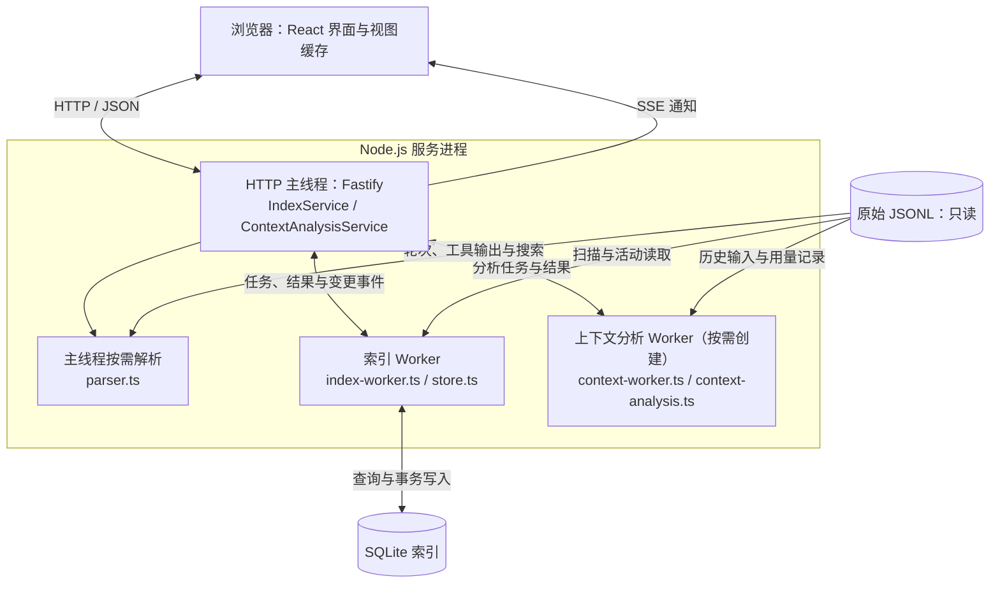
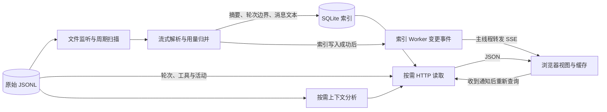

# 架构说明

会话观察台是本机运行的 Codex 日志浏览器。原始 JSONL 是事实来源，SQLite 提供可重建的查询索引，浏览器通过 HTTP 按需读取数据并通过 SSE 获知变化。

本文只说明模块、数据流和设计边界。接口参数、响应结构、错误约定与 SSE 帧格式见 [前后端契约](frontend-backend-contract.md)；运行方式与配置见 [README](../README.md)。

## 运行结构

图中各 Worker 使用 Node.js `worker_threads`，与主线程处于同一进程，但拥有独立的 JavaScript 内存与模块缓存。SQLite 连接由索引 Worker 持有；同一个 `parser.ts` 在不同线程中的解析缓存也彼此独立。

| 模块 | 职责与入口 |
| --- | --- |
| 浏览器 | [App.tsx](../client/App.tsx) 管理列表、当前会话和 SSE 订阅；轮次、工具正文与协作分支按需读取；[shared/types.ts](../shared/types.ts) 提供前后端共享类型 |
| HTTP 主线程 | [main.ts](../server/main.ts) 读取配置、启动索引和 HTTP 服务；[app.ts](../server/app.ts) 负责访问检查、参数校验、路由、错误响应和 SSE。轮次详情、工具输出及工具搜索在此线程调用解析器 |
| 索引服务 / Worker | [indexer.ts](../server/indexer.ts) 在主线程转发查询并管理 Worker 生命周期；[index-worker.ts](../server/index-worker.ts) 监听和扫描文件、调用解析器、处理活动读取；[store.ts](../server/store.ts) 管理 SQLite 摘要、轮次信息和消息搜索索引 |
| 上下文分析服务 / Worker | [context-service.ts](../server/context-service.ts) 在主线程管理 Worker 创建、任务数量与超时；[context-worker.ts](../server/context-worker.ts) 串行执行分析、来源查询及调用对比；[context-analysis.ts](../server/context-analysis.ts) 还原候选输入并在本地分词估算 |

开发时，Vite 提供页面并将 `/api` 代理到 Fastify；生产时，Fastify 同时提供构建后的静态资源与 API，见 [vite.config.ts](../vite.config.ts) 和 [main.ts](../server/main.ts)。

## 数据流

1. **发现与索引**：启动扫描、文件监听和周期重扫共同发现新增、追加与删除。解析器逐行读取 JSONL，建立轮次边界、工具输出位置与用量账本；索引 Worker 将会话摘要、轮次信息和用户、助手及进度消息文本事务写入 SQLite。Worker 启动就绪与全量扫描完成是两个阶段，扫描期间可以查询已发现结果。
2. **按需读取**：列表、会话摘要和子会话关系来自 SQLite；完整轮次、工具输出和工具搜索由 HTTP 主线程读取 JSONL；活动数据通过索引 Worker 读取。完整工具输出不进入 SQLite，浏览器按需分页加载。用量归并逻辑集中在 [usage.ts](../server/usage.ts)。
3. **上下文分析**：主线程先定位模型调用，再将文件路径和调用元数据交给分析 Worker；Worker 从历史日志恢复候选输入、估算分类和来源，或与同会话中的前一条调用比较。基础分析返回计数和依据，来源查询与调用对比可返回短预览。
4. **通知与刷新**：索引变化由 Worker 经 `IndexService` 转为 SSE。浏览器更新进度，并合并刷新列表、当前会话和已加载的协作节点。SSE 携带失效通知，正文仍通过 HTTP 重取；连接建立或重连后的 `ready` 也触发刷新。

## 缓存与一致性

| 层次 | 复用与失效依据 |
| --- | --- |
| SQLite 持久索引 | 数据库按日志根目录与索引 schema 版本区分；文件大小和修改时间未变时跳过重建。解析期间发生写入的文件不会被标为稳定，留待后续扫描更新 |
| 解析器内存 | 按文件路径缓存解析状态并合并并发读取；文件大小和修改时间用于判断是否变化。变化后结合文件身份、头部样本和上次读取位置附近的锚点判断能否继续解析追加内容，否则重新解析 |
| 分析 Worker 内存 | 按文件、调用与输入量缓存分析及来源；结合文件身份、大小、修改时间、头部样本与调用边界锚点判断复用，允许安全复用追加日志之前的分析结果 |
| 浏览器内存 | [轮次缓存](../client/turn-detail-cache.ts) 保存会话、轮次及 `revision`；版本变化后重新请求。[工具窗口](../client/useToolOutput.ts) 按版本区分内容，[协作视图](../client/useCollaboration.ts) 按 SSE 通知重取已加载节点。轮次缓存和工具输出窗口有容量限制 |

`revision` 是文件版本标识，前端只比较是否变化。请求取消与版本检查用于阻止旧响应覆盖新视图；浏览器中的阅读位置和工具滚动位置与正文缓存分开保存。

索引摘要与直接读取 JSONL 不是原子快照，文件持续写入时可能短暂不一致。文件监听去抖、定期重扫与前端刷新共同收敛到新状态，不能假设每次写入都有一条 SSE，或每次收到事件后立即读到所有更新。断线期间的事件不重放，应在重连后重新查询。

### 切换日志目录

设置变更在 [app.ts](../server/app.ts) 中串行执行：校验并规范化目录，停止旧索引 Worker，启动新目录对应的 Worker 与数据库，再保存设置并更新内存设置。切换或保存失败时尝试恢复原索引；恢复失败会记录错误。

[config.ts](../server/config.ts) 通过临时文件加重命名保存设置。不同日志根目录使用独立索引，切回时可复用未变化文件的摘要；目录切换会发出会话集合变化通知，浏览器据此重新读取。数据目录中的索引可以删除后重建，原始日志始终保留为事实来源。

## 设计取舍与约束

- **Worker 隔离重任务**：同步 SQLite 查询与索引扫描位于索引 Worker，分词位于独立分析 Worker，避免分词阻塞 HTTP 或索引。按需轮次和工具解析仍在 HTTP 主线程，不应将其误认为全部后台执行。
- **摘要优先、正文按需**：SQLite 支持列表、关系与消息搜索，JSONL 保留完整记录；浏览器分批读取轮次和长输出，限制大型日志对首屏与内存的影响。
- **用量保留来源**：直接记录与累计快照差值分开标记，父子会话独立统计。上下文分类是可见文本估算，缺失边界、压缩、采样和未知值通过结果说明，不回写原始用量。
- **本地读取边界**：服务仅监听本机地址，检查 Host、Origin 与日志真实路径，不执行日志中的命令，不修改或上传日志。持久写入限于本地设置与可重建索引；浏览器保存自己的视图偏好和位置。

修改线程职责、数据读取路径、缓存依据或目录切换流程时同步更新本文；协议变化同步更新 [前后端契约](frontend-backend-contract.md)。性能与一致性回归入口见 [performance.test.ts](../tests/performance.test.ts)、[indexer.test.ts](../tests/indexer.test.ts)、[backend-review.test.ts](../tests/backend-review.test.ts) 和 [turn-detail-cache.test.ts](../tests/turn-detail-cache.test.ts)。
